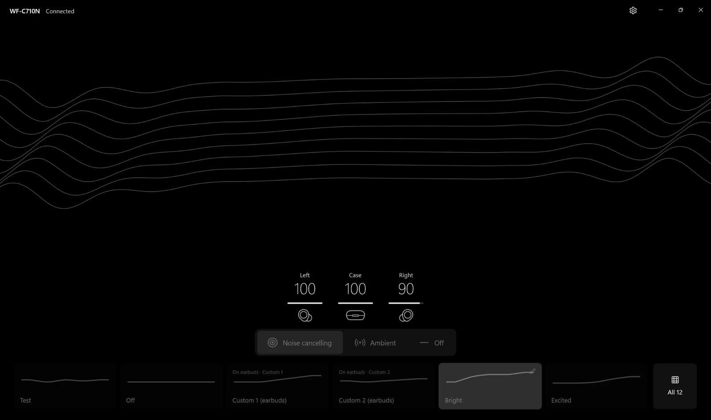
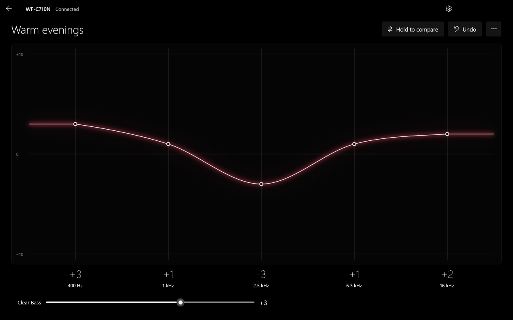
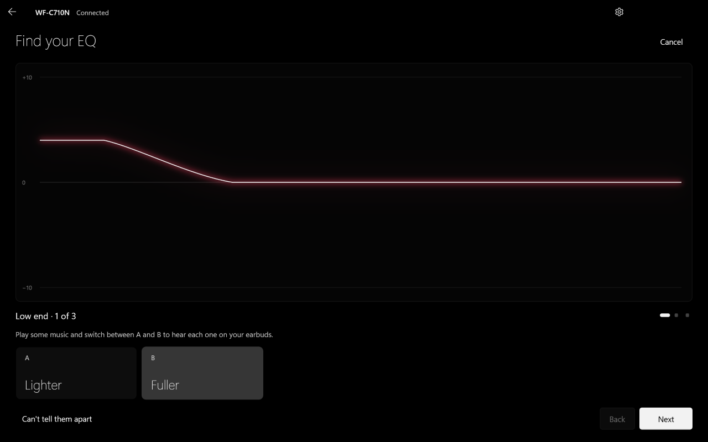
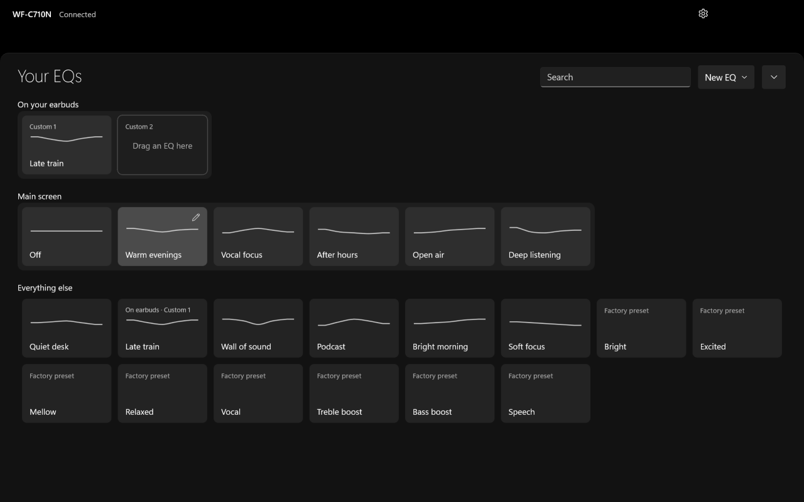

# Sound Connect

**Sound Connect** is a Windows 11 app and Win + W widget for Sony **WF-C710N** earbuds. It lets
you check the batteries, switch noise cancelling and ambient sound, and shape the sound with
your own EQs, without reaching for your phone.



## What it does

- **See everything at a glance:** left, right and case batteries, and whether each earbud is
  connected.
- **Switch sound modes instantly:** Noise cancelling, Ambient or Off. The waves on the main
  screen take the shape of the mode and glow softly in time with your music.
- **Keep an EQ library:** Sony's presets, with their real curves read from your earbuds, plus
  as many of your own EQs as you like. Six of them sit on the main screen, one tap away.
- **Edit with Sony's own controls:** five bands from 400 Hz to 16 kHz, plus Clear Bass. Changes
  play on your earbuds as you make them. Hold to compare against how it sounded before, and
  undo any step.
- **Find your EQ by ear:** three quick A/B rounds (low end, vocals, upper range) build an EQ
  from what you hear, not from numbers.
- **Take two EQs with you:** keep any EQ in the earbuds' Custom 1 and Custom 2 slots, for your
  phone and other devices. What's already in those slots is imported the first time you connect.
- **Change your earbuds' settings:** Bluetooth priority, DSEE, ambient level, voice focus, voice
  guidance, touch controls, the noise cycle and power options. Only the settings your earbuds
  support are shown.
- **Use the widget:** batteries, sound mode and your six main EQs in Win + W, without opening
  the app.
- **Keep it in the tray** when the window is closed, if you like.

| Edit an EQ | Find your EQ | Your EQs |
|---|---|---|
|  |  |  |

## Install

1. Turn on **Developer Mode** in Windows Settings > System > For developers. Windows only shows
   widgets from apps outside the Microsoft Store when it's on.
2. Pair your WF-C710N in Windows Bluetooth settings.
3. Download **EarbudControls-Setup-0.5.9.exe** from
   [Releases](https://github.com/KanuTomer/Sound-Connect/releases) and run it. It installs the
   app and the widget together.
4. Open **Sound Connect** from Start. To add the widget, open Win + W, choose Add widgets, then
   **WF-C710N**.

**Requirements:** Windows 11 x64, version 22H2 or newer, with the Windows Web Experience Pack
(for Widgets). Other earbud models and ARM64 PCs aren't supported.

**About the certificate:** Sound Connect is signed with the project's own certificate. The
first install asks for administrator permission once, only to trust that certificate; nothing
else runs as administrator. Windows SmartScreen may still warn the first time you download it.
Setup also installs Microsoft's Windows App Runtime if your PC doesn't already have it.

## Updates

Sound Connect checks for a new version once a day. When one is out, choose **Update** in the
title bar: it downloads, checks the file's checksum and signature, and updates in place,
keeping your EQs and settings. You can turn the check off in Settings > App and widget. Running
a newer setup yourself works the same way.

## Uninstall

Go to Windows Settings > Apps > Installed apps > **Sound Connect** > Uninstall. It asks whether
to remove your EQs and settings too, and keeps them unless you say so. Uninstalling never
changes your Bluetooth pairing or anything stored on the earbuds.

## Privacy

Sound Connect has no account and sends no telemetry. Your EQs and settings stay on your PC, in
`%LOCALAPPDATA%\Earbud Controls`. The only network request is the optional daily update check
to this project's GitHub Releases, which sends nothing about you.

## Build from source

You need Windows x64, Git, Visual Studio 2022 C++ Build Tools, Windows SDK 10.0.26100 and
CMake 3.31 or newer. In Windows PowerShell, from the repository folder:

```powershell
./scripts/build.ps1 -Check   # builds the app, widget and owner process, and runs the tests
./tests/install_tests.ps1    # checks the installer without installing anything
```

The build downloads pinned versions of its dependencies: the
[SonyHeadphonesClient](https://github.com/mos9527/SonyHeadphonesClient) engine, the Windows App
SDK and C++/WinRT.

## License

Sound Connect is an independent project, not affiliated with Sony or Microsoft. Its source is
MIT licensed. See [THIRD_PARTY_NOTICES.txt](THIRD_PARTY_NOTICES.txt) for the open-source
components it uses; Microsoft's redistributable packages keep their own license terms.
